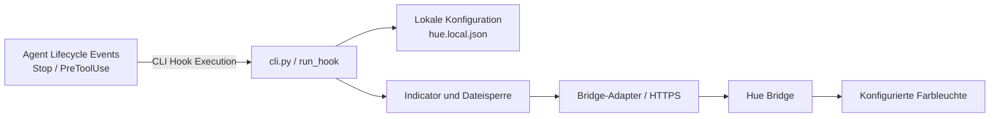

# Architektur

[Zur README](../README.md)

## Komponenten

| Datei / Modul | Verantwortung |
| --- | --- |
| `cli.py` | Argumente, Konfigurationsdatei, Pairing, Leuchtenauswahl, Hook- und Setup-Handler |
| `bridge.py` | HTTPS-/JSON-Adapter für Hue v2, Zustandssicherung, Farbmischung und Signalausführung |
| `locking.py` | Dateibasierte Betriebssystem-Sperre für konkurrierende lokale Prozesse |
| `__main__.py` | Start über `python -m hue_agent_feedback` |
| `tests/test_indicator.py` | Asynchrone Tests mit simuliertem Bridge-Adapter |
| `tests/test_cli.py` | Unit-Tests für Lifecycle Hooks, Stdin-Handling und Setup |

Lifecycle-Events wie `Stop` (Aufgabe fertig) und `PreToolUse` (Rückfrage via `ask_question`) werden auf Systemebene über `hooks.json` abgefangen. Die Ausführung erfolgt vollständig deterministisch und entlastet das Modell von Prompt-Regeln und Token-Aufwand.

## Aufrufablauf

1. Die lokale Konfiguration bei jedem Hook-/Signal-Aufruf laden.
2. Einen Bridge-Adapter erstellen und die konfigurierte Adresse prüfen.
3. Den aktuellen Zustand der Ziel-Leuchte lesen.
4. **Ausgeschaltete Leuchten sofort überspringen:** Ist das Licht aus (`on: false`), wird die Ausführung sofort beendet, ohne einen Schreibbefehl an die Bridge zu senden.
5. Ungeeignete Leuchten, Streaming-Modus und aktive dynamische Szenen ablehnen.
6. Eine Betriebssystem-Dateisperre für den Konfigurationspfad erwerben.
7. Wiederherstellbare Felder sichern (Ausgangsfarbe, Gradientenpunkte, Farbtemperatur, Effekte).
8. Ziel-Farbkoordinaten in die aktuellen Koordinaten mischen (22 % Standard). Die Benachrichtigungs-Payload verändert keine Helligkeit und schaltet die Leuchte nicht ein oder aus.
9. Zwei Übergänge zum gemischten Zustand mit jeweils anschließender Rückkehr ausführen.
10. Im `finally`-Block erneut den gesicherten Zustand schreiben und erst nach Abschluss die Sperre freigeben.
11. Für Antigravity Lifecycle Hooks: Valides JSON `{"decision": "allow"}` auf `stdout` ausgeben.

## Zustandssicherung

Gesichert werden Einschaltzustand, Helligkeit, gültige Weißtemperatur oder alternativ xy-Farbe, vorhandene Gradient-Punkte samt Modus sowie ein aktiver einfacher Effekt. Read-only-Felder wie Farbgamut oder `points_capable` werden nicht zurückgeschrieben.

Während einer Benachrichtigung wird ein gemeldeter einfacher Effekt auf `no_effect` gesetzt und bei vorher aktivem Effekt später wieder aktiviert. Erweiterte Effektparameter und dynamische Szenen werden nicht vollständig rekonstruiert.

## Fehler und Abbruch

Bridge-Requests laufen über `asyncio.to_thread`, damit die synchrone Standardbibliothek nicht direkt die Eventloop blockiert. Die abschließende Wiederherstellung ist mit `asyncio.shield` gegen gewöhnliche Task-Cancellation geschützt. Tritt ein Kommunikationsfehler auf, fängt der Hook-Handler diesen ab und gibt dennoch `{"decision": "allow"}` an Antigravity zurück, damit die Ausführung des Benutzers niemals blockiert wird.

## Sperrverhalten

Aus dem Konfigurationspfad wird mit `with_suffix('.lock')` der Sperrpfad gebildet: `hue.local.json` wird zu `hue.local.lock`. Windows nutzt `msvcrt.locking`, POSIX `fcntl.flock`. Die Datei bleibt als normaler Marker liegen; die aktive Sperre hängt am offenen Dateihandle.
