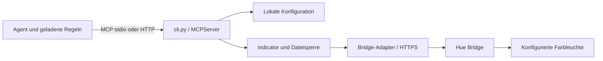

# Architektur

[Zur README](../README.md)

## Komponenten

| Datei | Verantwortung |
| --- | --- |
| `cli.py` | Argumente, Konfigurationsdatei, Pairing, Leuchtenauswahl und MCP-Werkzeugregistrierung |
| `bridge.py` | HTTPS-/JSON-Adapter für Hue v2, Zustandssicherung, Farbmischung und Signalausführung |
| `locking.py` | Dateibasierte Betriebssystem-Sperre für konkurrierende lokale Prozesse |
| `__main__.py` | Start über `python -m hue_task_mcp` |
| `tests/test_indicator.py` | Asynchrone Tests mit simuliertem Bridge-Adapter |

Der Agent erkennt den Aufgabenstatus und entscheidet über den Werkzeugaufruf. Der Server überwacht keine Fenster, Tastatureingaben, Chat-Inhalte oder Prozesse. Eine Benachrichtigung über einen tatsächlichen Client-Lifecycle-Hook wäre eine zusätzliche Integration außerhalb dieses Projekts.

## Aufrufablauf

1. Die lokale Konfiguration bei jedem MCP-Aufruf neu laden.
2. Einen Bridge-Adapter erstellen und die konfigurierte Adresse prüfen.
3. Eine Betriebssystem-Dateisperre für den Konfigurationspfad erwerben.
4. Den aktuellen Zustand der Ziel-Leuchte lesen.
5. Ungeeignete Leuchten, Streaming-Modus und aktive dynamische Szenen ablehnen.
6. Wiederherstellbare Felder sichern; bei ausgeschaltetem Licht ohne Schreibzugriff beenden.
7. Ziel-Farbkoordinaten in die aktuellen Koordinaten mischen. Bestehende Gradient-Punkte einzeln behandeln. Die Benachrichtigungs-Payload verändert keine Helligkeit und schaltet die Leuchte nicht ein oder aus.
8. Zwei Übergänge zum gemischten Zustand mit jeweils anschließender Rückkehr ausführen.
9. Im `finally`-Block erneut den gesicherten Zustand schreiben und erst nach Abschluss die Sperre freigeben.

Ohne Fehler sind das ein Light-GET und fünf Light-PUTs. Die Sequenz dauert mindestens ungefähr 5,6 s zuzüglich Requests und möglicher Sperrwartezeit. Es gibt keine dauerhafte Queue, Ereignis-ID oder Duplikaterkennung. Jeder Aufruf erzeugt sein eigenes Signal; gleichzeitige Anfragen werden serialisiert.

## Zustandssicherung

Gesichert werden Einschaltzustand, Helligkeit, gültige Weißtemperatur oder alternativ xy-Farbe, vorhandene Gradient-Punkte samt Modus sowie ein aktiver einfacher Effekt. Read-only-Felder wie Farbgamut oder `points_capable` werden nicht zurückgeschrieben.

Während einer Benachrichtigung wird ein gemeldeter einfacher Effekt auf `no_effect` gesetzt und bei vorher aktivem Effekt später wieder aktiviert. Erweiterte Effektparameter und dynamische Szenen werden nicht vollständig rekonstruiert. Eine Farbausgabe außerhalb des Leuchtengamuts wird nicht selbst auf den Gamut projiziert; die Darstellung hängt von der Bridge/Leuchte ab.

## Fehler und Abbruch

Bridge-Requests laufen über `asyncio.to_thread`, damit die synchrone Standardbibliothek nicht direkt die Eventloop blockiert. Ein Abbruch des wartenden Tasks beendet nicht zwingend einen bereits laufenden Netzwerk-Thread. Die abschließende Wiederherstellung ist mit `asyncio.shield` gegen gewöhnliche Task-Cancellation geschützt. Ein harter Prozessabbruch, erneuter Abbruch während der Bereinigung oder Stromausfall ist dadurch nicht abgesichert.

Die Sicherung wird bei `RuntimeError` bis zu dreimal versucht. Ein endgültiger Wiederherstellungsfehler kann den vorherigen Fehler überdecken. Es gibt kein dauerhaftes Wiederherstellungsjournal und keine nachträgliche Reparatur nach Prozessneustart.

## Sperrverhalten

Aus dem Konfigurationspfad wird mit `with_suffix('.lock')` der Sperrpfad gebildet: `hue.local.json` wird zu `hue.local.lock`. Windows nutzt `msvcrt.locking`, POSIX `fcntl.flock`. Die Datei bleibt als normaler Marker liegen; die aktive Sperre hängt am offenen Dateihandle.

Für mehrere Clients **denselben absoluten Konfigurationspfad** verwenden. Getrennte Dateien mit derselben Light-UUID erzeugen getrennte Sperren und können sich gegenseitig überschreiben. Die Synchronisierung gilt für lokale Prozesse mit kompatibler Dateisperre, nicht für beliebige Hosts oder Netzlaufwerke.

## Transport

Die offizielle MCP-Python-SDK stellt stdio und stateless Streamable HTTP bereit. Der HTTP-Modus verwendet JSON-Antworten und bindet ausschließlich an Loopback. Pairing und Lichtänderungen werden nicht als eigene HTTP-REST-Endpunkte angeboten; über HTTP sind dieselben drei MCP-Werkzeuge erreichbar.

Zugang zu ChatGPT aus dem Browser ist eine separate Tunnel-/Authentifizierungsaufgabe. Kein öffentlicher Reverse Proxy und kein OAuth-Server werden durch dieses Projekt eingerichtet.
